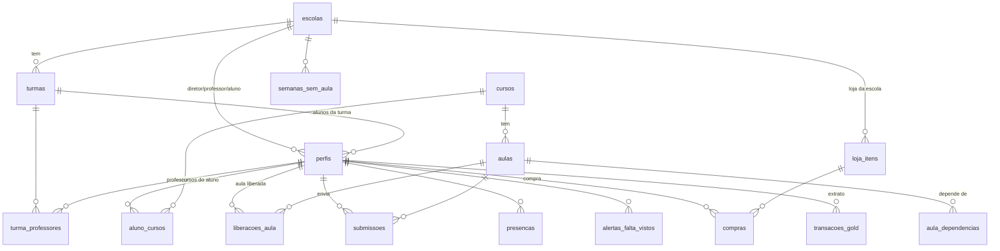

# Modelo do Banco — Supabase (PostgreSQL)

> Derivado de `requisitos.md`. Versão 1 — para revisão antes de virar SQL.

## 1. Visão geral

**Três blocos:**
- **Pessoas:** `escolas`, `turmas`, `perfis`, `turma_professores`
- **Conteúdo e progresso:** `cursos`, `aulas`, `aula_dependencias`, `aluno_cursos`, `liberacoes_aula`, `submissoes`
- **Frequência:** `presencas`, `semanas_sem_aula`, `alertas_falta_vistos`
- **Loja e Gold:** `loja_itens`, `compras`, `transacoes_gold`

## 2. Tabelas

### Pessoas

**`escolas`**
| Coluna | Tipo | Observação |
|---|---|---|
| id | uuid PK | |
| nome | text | obrigatório |
| endereco | text | |
| telefone | text | |
| ativa | boolean | padrão `true` |
| criado_em | timestamptz | |

**`perfis`** — um registro por usuário, ligado ao login do Supabase Auth
| Coluna | Tipo | Observação |
|---|---|---|
| id | uuid PK | = `auth.users.id` |
| nome | text | |
| email | text | |
| papel | enum `admin` · `diretor` · `professor` · `aluno` | |
| escola_id | uuid → escolas | obrigatório, exceto admin |
| turma_id | uuid → turmas | só para aluno |
| gold_saldo | integer | padrão 0, **nunca negativo** (`check >= 0`) |
| ativo | boolean | |
| ultimo_login_em | timestamptz | usado para expirar a sessão em 2h |
| criado_em | timestamptz | |

**`turmas`**
| Coluna | Tipo | Observação |
|---|---|---|
| id | uuid PK | |
| escola_id | uuid → escolas | **obrigatório** (corrige falha da referência) |
| nome | text | ex.: "Segunda 19:30" |
| periodo | enum `manha` · `tarde` · `noite` | |
| dia_semana | smallint (0 = domingo … 6 = sábado) | dia da aula — base do cálculo de faltas |
| horario_inicio | time | ex.: 19:30 |
| horario_fim | time | ex.: 21:00 |
| ativa | boolean | |

**`semanas_sem_aula`** — feriados/recessos que não contam como falta (RF99)
| Coluna | Tipo | Observação |
|---|---|---|
| id | uuid PK | |
| escola_id | uuid → escolas | |
| turma_id | uuid → turmas | vazio = vale para a escola toda |
| data | date | dia em que não houve aula |
| motivo | text | ex.: "Feriado" |

**`alertas_falta_vistos`** — professor/diretor marca "visto/contatado" (RF98)
| Coluna | Tipo | Observação |
|---|---|---|
| id | uuid PK | |
| aluno_id | uuid → perfis | |
| faltas_no_momento | integer | quantas faltas seguidas havia quando foi marcado |
| visto_por | uuid → perfis | |
| visto_em | timestamptz | |
| observacao | text | ex.: "Liguei para a mãe" |

**`turma_professores`** — um professor pode ter várias turmas e vice-versa
| Coluna | Tipo |
|---|---|
| turma_id | uuid → turmas |
| professor_id | uuid → perfis |
| PK | (turma_id, professor_id) |

### Conteúdo

**`cursos`**
| Coluna | Tipo | Observação |
|---|---|---|
| id | uuid PK | |
| nome | text | "Desenvolvedor Júnior", "Desenvolvedor Pleno" |
| descricao | text | |
| ordem | integer | |
| ativo | boolean | |

**`aulas`**
| Coluna | Tipo | Observação |
|---|---|---|
| id | uuid PK | |
| curso_id | uuid → cursos | |
| titulo | text | |
| numero_missao | integer | "#1", "#2"… |
| descricao | text | |
| figma_embed_url | text | validar `embed.figma.com` |
| camada | integer | posição no mapa (0, 1, 2…) |
| ordem | integer | ordem dentro da camada |
| dificuldade | enum `facil` · `medio` · `dificil` | |
| tempo_estimado_min | integer | ex.: 45 |
| gold_recompensa | integer | Gold creditado na aprovação |
| dica_envio | text | |
| ativa | boolean | |
| criado_por | uuid → perfis | |

**`aula_dependencias`** — "para fazer X, precisa ter concluído Y"
| Coluna | Tipo |
|---|---|
| aula_id | uuid → aulas |
| depende_de_id | uuid → aulas |
| PK | (aula_id, depende_de_id) |

### Acesso e progresso

**`aluno_cursos`** — quais cursos cada aluno faz (RF43/RF44)
| Coluna | Tipo | Observação |
|---|---|---|
| aluno_id | uuid → perfis | |
| curso_id | uuid → cursos | |
| tudo_liberado | boolean | `true` = curso inteiro desbloqueado, ignora dependências |
| liberado_por | uuid → perfis | |
| liberado_em | timestamptz | |
| PK | (aluno_id, curso_id) | |

**`liberacoes_aula`** — aula liberada manualmente, com histórico (RF45–RF48)
| Coluna | Tipo | Observação |
|---|---|---|
| id | uuid PK | |
| aluno_id | uuid → perfis | |
| aula_id | uuid → aulas | |
| liberado_por | uuid → perfis | |
| liberado_em | timestamptz | |
| revogado_por | uuid → perfis | preenchido ao bloquear de novo |
| revogado_em | timestamptz | |

**`submissoes`** — cada envio é uma linha (reenvio = nova linha → histórico completo)
| Coluna | Tipo | Observação |
|---|---|---|
| id | uuid PK | |
| aluno_id | uuid → perfis | |
| aula_id | uuid → aulas | |
| link | text | Drive, Dropbox, GitHub |
| status | enum `nova` · `aprovada` · `devolvida` | |
| comentario | text | do avaliador |
| avaliado_por | uuid → perfis | |
| avaliado_em | timestamptz | |
| enviado_em | timestamptz | |

**`presencas`** — 1 por aluno por dia, criada no login
| Coluna | Tipo | Observação |
|---|---|---|
| id | uuid PK | |
| aluno_id | uuid → perfis | |
| data | date | `unique (aluno_id, data)` |
| registrado_em | timestamptz | hora do primeiro login do dia |

### Loja e Gold

**`loja_itens`**
| Coluna | Tipo | Observação |
|---|---|---|
| id | uuid PK | |
| escola_id | uuid → escolas | **cada escola tem a sua loja** |
| nome | text | |
| descricao | text | |
| tipo | enum `modelo_3d` · `template_botao` · `unitypack` · `animacao` · `horas_gaming` | |
| preco_gold | integer | > 0 |
| imagem_path | text | bucket público `loja-imagens` |
| arquivo_path | text | bucket **privado** `loja-arquivos` (itens digitais) |
| horas | numeric | só para `horas_gaming` |
| ativo | boolean | desativar sem excluir |

**`compras`**
| Coluna | Tipo | Observação |
|---|---|---|
| id | uuid PK | |
| aluno_id | uuid → perfis | |
| item_id | uuid → loja_itens | |
| preco_pago | integer | guarda o preço da época |
| status | enum `concluida` · `aguardando_aviso` · `avisado` | digitais = `concluida`; horas = `aguardando_aviso` |
| avisado_por | uuid → perfis | professor que avisou a Gaming House |
| avisado_em | timestamptz | |
| criado_em | timestamptz | |

**`transacoes_gold`** — extrato; toda mudança de saldo passa por aqui
| Coluna | Tipo | Observação |
|---|---|---|
| id | uuid PK | |
| aluno_id | uuid → perfis | |
| valor | integer | positivo = ganho, negativo = gasto |
| motivo | enum `aula_aprovada` · `compra` · `ajuste_manual` | |
| submissao_id | uuid → submissoes | se `aula_aprovada` |
| compra_id | uuid → compras | se `compra` |
| descricao | text | obrigatório se `ajuste_manual` |
| criado_por | uuid → perfis | |
| criado_em | timestamptz | |

## 3. O que é calculado (não fica guardado)

| Informação | Como sai |
|---|---|
| **Estado da aula no mapa** | ✓ concluída = tem submissão `aprovada` · ⏳ pendente = última submissão `nova` · 🔙 devolvida = última `devolvida` · ► disponível = todas as dependências aprovadas **ou** liberação manual ativa **ou** `tudo_liberado` · 🔒 bloqueada = nenhum dos anteriores |
| Progresso do aluno (%) | aulas aprovadas ÷ aulas do curso |
| Aula atual | primeira aula disponível ainda não aprovada |
| Status no trilho / atrasado | a partir da data da última aprovação (regra a definir) |
| **Faltas seguidas** | conta as datas de aula da turma (`dia_semana`), da mais recente para trás, ignorando `semanas_sem_aula`, até achar uma semana com registro em `presencas`. Resultado: 0 = normal · 1 = 🟡 amarelo · 2+ = 🔴 vermelho |
| **Aviso para o professor** | alunos das suas turmas com 2+ faltas seguidas que **não** têm um `alertas_falta_vistos` com o mesmo número de faltas |
| Dashboard e análise | consultas sobre `submissoes`, `presencas`, `perfis` |

## 4. Operações que precisam ser atômicas (funções no banco)

| Função | O que faz numa única transação |
|---|---|
| `aprovar_submissao(id, comentario)` | marca `aprovada` → cria transação `+gold` → soma no `gold_saldo` |
| `devolver_submissao(id, comentario)` | marca `devolvida` com comentário |
| `comprar_item(item_id)` | confere saldo e escola → cria compra → transação `-preco` → desconta saldo |
| `ajustar_gold(aluno_id, valor, motivo)` | transação manual + ajuste do saldo |
| `registrar_login()` | atualiza `ultimo_login_em` e cria a presença do dia (se não existir) |

O aluno **nunca** altera `gold_saldo` diretamente — só por essas funções.

## 5. Permissões (RLS) — resumo

| Tabela | Aluno | Professor | Diretor | Admin |
|---|---|---|---|---|
| perfis | o próprio | alunos das suas turmas | todos da sua escola | todos |
| turmas | a sua | as suas | da sua escola | todas |
| aulas / cursos | cursos liberados (leitura) | ler e editar | ler e editar | tudo |
| aluno_cursos / liberacoes_aula | as suas (leitura) | alunos das suas turmas | alunos da escola | tudo |
| submissoes | criar e ler as suas | avaliar das suas turmas | avaliar da escola | tudo |
| presencas | as suas | alunos das suas turmas | alunos da escola | tudo |
| semanas_sem_aula | — | ler; criar para suas turmas | da escola | tudo |
| alertas_falta_vistos | — | alunos das suas turmas | alunos da escola | tudo |
| loja_itens | ler os ativos da sua escola | ler | editar os da sua escola | tudo |
| compras | as suas (criar via função) | ler e marcar "avisado" das suas turmas | da escola | tudo |
| transacoes_gold | as suas (leitura) | alunos das suas turmas | da escola | tudo |

**Storage:**
- `loja-imagens` — público (só imagens de vitrine)
- `loja-arquivos` — privado; download por link temporário, gerado só se existe compra do aluno para aquele item

## 6. Sessão de 2 horas

`registrar_login()` grava `ultimo_login_em`. O middleware do Next.js confere em toda requisição: se passou de 2h, faz logout e manda para o login. Recarregar a página **não** derruba a sessão antes disso.
